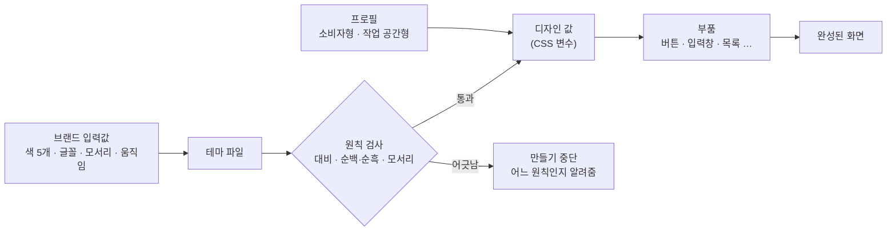
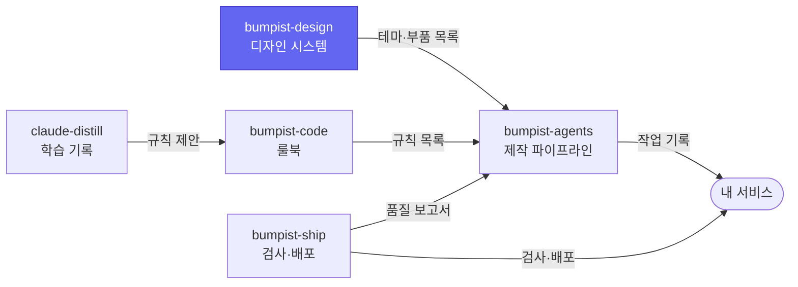

# bumpist-design

**서비스마다 색과 글꼴만 바꾸면, 화면의 완성도는 그대로 따라오는 디자인 시스템이에요.**

새 서비스를 만들 때마다 버튼 모양, 여백, 색을 처음부터 다시 정하지 않아도 돼요. 브랜드 색 다섯 개를 넣으면 나머지 디자인 값이 계산되고, 정해 둔 원칙을 어기는 값은 만들어지기 전에 걸러져요.

> **지금 상태 — v0 (0단계).** 설계, 원칙 검사, 첫 테마 초안(paper)까지 있어요. 실제 디자인 값과 부품, Storybook 화면은 다음 단계(design v0.1)부터 만들어지고, npm으로 설치하는 정식 배포는 v1.0이에요. 아래 [지금 되는 것과 아직 안 되는 것](#지금-되는-것과-아직-안-되는-것)에 정리했어요.

## 어떤 문제를 푸나요

| 지금까지 | bumpist-design을 쓰면 |
| --- | --- |
| 서비스마다 버튼·여백·색을 새로 정해서 매번 조금씩 달라져요 | 디자인 값은 한 곳에서 오고, 서비스마다 바뀌는 건 브랜드 색과 글꼴뿐이에요 |
| AI에게 화면을 맡기면 하얀 바탕, 회색 테두리, 왼쪽 메뉴가 있는 '어디서 본 화면'이 나와요 | 원칙을 어기는 값은 디자인 시스템이 아예 내보내지 않아요 |
| 색을 바꾸다 보면 글자가 잘 안 읽히는 조합이 생겨요 | 모든 색 조합의 대비를 계산해서, 기준에 못 미치면 만들기 단계에서 멈춰요 |

## 어떻게 동작하나요



- **테마**는 서비스의 개성이에요. 색, 글꼴, 모서리 둥글기, 움직임 속도를 정해요.
- **프로필**은 서비스의 쓰임새예요. 휴대폰으로 잠깐 쓰는 서비스인지(소비자형), 책상에서 오래 일하는 도구인지(작업 공간형)에 따라 여백과 화면 배치가 달라져요.
- **원칙 검사**는 사람이 보기 전에 기계가 먼저 해요. 그래서 원칙은 지켜 달라는 부탁이 아니라 지켜질 수밖에 없는 규칙이에요.

## 모든 테마가 지키는 디자인 원칙

테두리와 그림자 대신 넓은 여백과 글자 크기 차이로 화면을 나누는 것을 지향해요.

| 원칙 | 쉽게 말하면 | 누가 지키게 하나 |
| --- | --- | --- |
| 배경은 순백이 아니다 | 눈부신 흰색(#FFFFFF) 대신 살짝 톤이 있는 밝은 색 | 디자인 값 만들기 단계 |
| 가장 진한 글자도 순흑이 아니다 | 새까만 글자(#000000) 대신 아주 진한 남색·회색 | 디자인 값 만들기 단계 |
| 구역은 여백으로 나눈다 | 칸막이 선과 그림자 대신 간격과 글자 크기로 구분 | 코드 검사 + 리뷰 |
| 모서리는 12px 또는 16px | 버튼·입력창은 12px, 카드는 16px로 통일 | 디자인 값 만들기 단계 |
| 숨 쉬는 여백 | 요소 사이 최소 24px (작업 공간형은 16px) | 디자인 값 + 리뷰 |
| 휴대폰 먼저 | 소비자형은 좁은 화면부터, 넓어져도 한 줄 흐름 | 화면별 미리보기 필수 |
| 흔한 관리자 화면 금지 | 소비자형에서는 왼쪽 메뉴 + 위쪽 메뉴 조합을 쓰지 않음 | 부품 목록에서 제외 + 리뷰 |
| 아이콘을 상자에 가두지 않는다 | 네모 배경 안의 아이콘, 의미 없이 늘어놓은 아이콘 금지 | 리뷰 |
| 신호등 색 금지 | 성공·주의·오류를 원색 초록·노랑·빨강이 아니라 브랜드 색의 밝기 차이로, 항상 글과 아이콘을 함께 | 디자인 값 만들기 단계 |

## 테마

색 칩은 라이트 모드 기준 초안이에요. 정식 값은 대비 검사를 통과한 뒤에 확정돼요.

| 테마 | 느낌 | 어울리는 서비스 | 메인 색 | 서브 색 | 배경 | 모서리 | 나오는 버전 |
| --- | --- | --- | --- | --- | --- | --- | --- |
| **paper** (기본) | 담백하고 정돈된 느낌 | SaaS, 생산성 도구 |  `#6366F1` |  `#F43F5E` |  `#F8FAFC` | 12px | v1.0 |
| **midnight** | 어두운 화면이 기본 | 개발 도구, 모니터링 |  `#22D3EE` |  `#A78BFA` |  `#0B1020` | 12px | v1.0 |
| **clinic** | 부드럽고 믿음직한 느낌 | 헬스케어, 핀테크, 예약 |  `#14B8A6` |  `#FB7185` |  `#F6FAF9` | 16px | v1.0 |
| **studio** | 잡지 같은 편집 디자인 | 콘텐츠, 커머스, 포트폴리오 |  `#166534` |  `#CA8A04` |  `#FAF7F2` | 12px | v1.1 |
| **bold** | 큰 글자로 힘 있게 | 크리에이터, 이벤트, 출시 페이지 |  `#2563EB` |  `#F97316` |  `#F5F5F4` | 12px | v1.1 |
| **pop** | 밝고 친근한 느낌 | 소비자 앱, 커뮤니티, 교육 |  `#8B5CF6` |  `#F472B6` |  `#FBF7FF` | 16px | v1.1 |

## 두 가지 프로필

| | 소비자형 | 작업 공간형 |
| --- | --- | --- |
| 이런 서비스 | 휴대폰으로 잠깐 들어와 한두 가지 일을 끝내는 서비스 | 하루에 여러 번, 오래 쓰는 업무 도구 |
| 먼저 설계하는 화면 폭 | 375px (휴대폰) | 1280px (노트북) |
| 요소 사이 여백 | 24px 이상 | 16px 이상 |
| 화면 배치 | 가운데 한 줄 흐름, 또는 타일형 배치 | 접히는 왼쪽 메뉴 + 얇은 위쪽 메뉴 허용 |

대부분의 SaaS는 둘을 섞어요. 회원가입 같은 바깥 페이지는 소비자형, 로그인한 뒤의 앱 화면은 작업 공간형으로 쓰면 돼요.

## 써 보기

### 개발자가 아니라면

위의 **원칙**, **테마**, **프로필** 표만 읽어도 이 디자인 시스템이 무엇을 약속하는지 알 수 있어요. 새 서비스의 느낌을 정할 때 테마 표에서 가장 가까운 것을 고르면, 그게 개발자에게 넘길 첫 번째 결정이에요.

### 개발자라면 (지금 해 볼 수 있는 것)

지금은 테마 초안이 원칙을 지키는지 검사하는 것까지 할 수 있어요.

```bash
git clone https://github.com/parksubeom/bumpist-design.git
cd bumpist-design
pnpm install
pnpm check:schemas
```

`✓ paper.tokens.json`이 보이면 통과예요. `packages/tokens/src/themes/paper.tokens.json`의 라이트 배경색(`bg`)을 `#FFFFFF`로 바꾸고 다시 돌려 보세요. `UI-003 light bg is pure white`로 멈춰요. 원칙이 실제로 동작한다는 걸 이렇게 확인할 수 있어요.

## 지금 되는 것과 아직 안 되는 것

| 시점 | 들어오는 것 |
| --- | --- |
| **지금 (v0)** | 테마 형식(C1)과 부품 목록 형식(C2) 정의, paper 테마 초안, 순백·순흑·모서리 원칙 검사 |
| design v0.1 (2~6주차) | paper 테마를 실제 CSS 변수로 만들기, 모든 색 조합의 대비 검사, 부품 10개, Storybook 화면, 부품 목록 파일 |
| design v0.5 (7~12주차) | 테마 3종(paper·midnight·clinic) × 프로필 2종, 부품 22개, 화면 블록 6개 |
| v1.0 (13~16주차) | npm 공개 배포(`@bumpist/tokens`, `@bumpist/ui`), Storybook 사이트 공개 |
| v1.1 (17~22주차) | 나머지 테마 3종, 부품 13개, 블록 5개, 서비스별 브랜드 표현(일러스트·문구 톤) |

## 이런 경우엔 맞지 않아요

- **화면 부품은 React용이에요.** Vue나 Svelte라면 디자인 값(CSS 변수)만 가져다 쓸 수 있고, 부품은 직접 만들어야 해요.
- **원칙을 바꾸고 싶다면 맞지 않아요.** 순백 배경이나 테두리 중심의 디자인이 필요한 서비스라면, 이 디자인 시스템과 계속 부딪힐 거예요.
- **지금 당장 설치해서 쓸 수는 없어요.** 정식 배포는 v1.0이에요.

## 다른 도구가 읽는 파일 형식

다른 도구가 이 디자인 시스템을 이해할 수 있도록, 주고받는 파일의 형식을 공개해 두었어요. 다른 디자인 시스템도 이 형식만 맞추면 [bumpist-agents](https://github.com/parksubeom/bumpist-agents)와 함께 쓸 수 있어요.

| 형식 | 담는 것 | 정의 |
| --- | --- | --- |
| C1 테마 | 테마 하나의 색·글꼴·모서리, 모드별 값, 프로필별 여백 | [`schemas/theme/v0.json`](https://parksubeom.github.io/bumpist-design/schemas/theme/v0.json) |
| C2 부품 목록 | 부품마다 언제 쓰는지, 언제 쓰면 안 되는지, 필요한 상태 | [`schemas/catalog/v0.json`](https://parksubeom.github.io/bumpist-design/schemas/catalog/v0.json) |

## Bumpist Suite 안에서

다섯 저장소는 서로의 코드를 가져다 쓰지 않고, 정해진 형식의 파일만 주고받아요. 그래서 하나만 골라 써도 되고, 모두 연결해 쓸 수도 있어요. 색칠된 칸이 이 저장소예요.

| 저장소 | 한 줄 설명 |
| --- | --- |
| [bumpist-design](https://github.com/parksubeom/bumpist-design) | 서비스마다 색만 바꾸면 되는 디자인 시스템 |
| [bumpist-agents](https://github.com/parksubeom/bumpist-agents) | 아이디어에서 미리보기 링크까지 가는 Claude Code 작업 순서 |
| [bumpist-code](https://github.com/parksubeom/bumpist-code) | AI가 매번 같은 방식으로 코드를 쓰게 하는 룰북 |
| [bumpist-ship](https://github.com/parksubeom/bumpist-ship) | 파일 하나로 붙이는 자동 검사·배포 |
| [claude-distill](https://github.com/parksubeom/claude-distill) | Claude가 대화에서 배운 것을 자동으로 기록 |



## 라이선스

MIT
