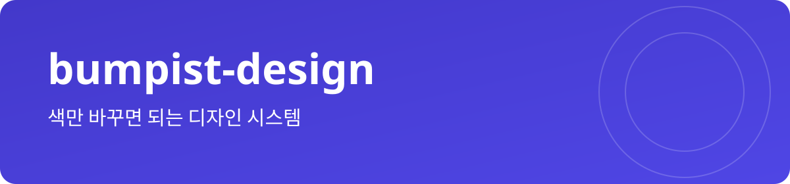
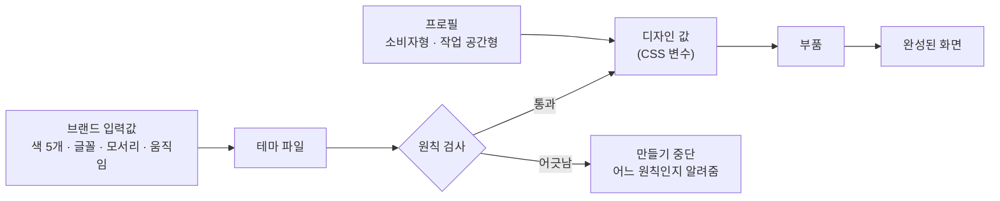

<h1 align="center"></h1>

<p align="center">
  
  
  
</p>

<p align="center">
  <a href="#써-보기">써 보기</a> · <a href="#디자인-원칙">디자인 원칙</a> · <a href="#테마와-프로필">테마와 프로필</a> · <a href="#bumpist-저장소">다른 저장소</a>
</p>

브랜드 색 다섯 개만 넣으면, 나머지 디자인 값은 알아서 맞춰지는 디자인 시스템이에요.

> [!NOTE]
> 지금은 v0이에요. paper 테마를 CSS 변수와 Tailwind 설정으로 만들 수 있고, 만들 때 대비와 원칙을 검사해요. 실제 부품과 Storybook은 v0.1부터, npm 설치는 v1.0부터 돼요.

## 왜 필요한가요

- 서비스마다 버튼, 여백, 색을 새로 정하다 보면 매번 조금씩 달라져요.
- AI에게 화면을 맡기면 하얀 바탕에 회색 테두리, 어디서 본 듯한 화면이 나와요.
- 색을 바꾸다 보면 글자가 잘 안 읽히는 조합이 생겨요.

bumpist-design은 디자인 값을 한 곳에서 내보내요. 서비스마다 바꾸는 건 브랜드 색과 글꼴뿐이고, 원칙을 어기는 값은 아예 만들어지지 않아요.

## 써 보기

지금은 paper 테마로 디자인 값을 만들어 볼 수 있어요.

```bash
git clone https://github.com/parksubeom/bumpist-design.git
cd bumpist-design
pnpm install
pnpm build
```

`✓ paper: 22 contrast pairs pass`가 보이면 통과예요. `packages/tokens/dist/`에 `tokens.css`, `tailwind.css`, `tokens.json`이 생겨요.

> [!TIP]
> `packages/tokens/src/themes/paper.tokens.json`에서 라이트 배경색(`bg`)을 `#FFFFFF`로 바꾸고 다시 만들어 보세요. `paper light: UI-003 bg is pure white`로 멈추고 아무 파일도 만들지 않아요. 원칙이 실제로 동작하는 걸 볼 수 있어요.

개발자가 아니라면 아래 [디자인 원칙](#디자인-원칙)과 [테마](#테마와-프로필)만 읽어도 돼요. 새 서비스의 느낌을 정할 때 가장 가까운 테마를 고르면, 그게 개발자에게 넘길 첫 결정이에요.

## 어떻게 동작하나요

1. 브랜드 입력값(색 다섯 개, 글꼴, 모서리, 움직임)으로 테마 파일을 만들어요.
2. 테마가 원칙 검사를 통과하면 디자인 값(CSS 변수)이 나와요. 어긋나면 어느 원칙인지 알려 주고 멈춰요.
3. 디자인 값으로 부품(버튼, 입력창, 목록)을 만들고, 부품으로 화면을 만들어요.

**테마**는 서비스의 개성(색, 글꼴, 모서리, 움직임)이고, **프로필**은 서비스의 쓰임새(휴대폰용인지 업무용인지)예요.

<details>
<summary>같은 흐름을 그림으로 보기</summary>



</details>

## 디자인 원칙

테두리와 그림자 대신, 넓은 여백과 글자 크기 차이로 화면을 나눠요. 모든 테마가 아래 원칙을 지켜요.

- 배경은 순백(#FFFFFF)이 아니라 살짝 톤이 있는 밝은 색이에요.
- 가장 진한 글자도 순흑(#000000)이 아니라 아주 진한 남색이나 회색이에요.
- 구역은 칸막이 선이 아니라 여백과 글자 크기로 나눠요.
- 모서리는 버튼과 입력창 12px, 카드 16px로 맞춰요.
- 요소 사이는 최소 24px 띄워요. 작업 공간형은 16px이에요.
- 소비자형은 휴대폰 화면부터 설계해요.
- 소비자형에서는 왼쪽 메뉴와 위쪽 메뉴를 함께 쓰는 흔한 관리자 화면을 쓰지 않아요.
- 아이콘을 네모 상자에 가두거나 의미 없이 늘어놓지 않아요.
- 성공, 주의, 오류를 초록, 노랑, 빨강 원색 대신 브랜드 색의 밝기 차이로 보여 주고, 항상 글과 아이콘을 함께 써요.

<details>
<summary>원칙마다 누가 지키게 하나요</summary>

| 원칙 | 지키게 하는 곳 |
| --- | --- |
| 배경은 순백이 아니다 | 디자인 값 만들기 단계 |
| 가장 진한 글자도 순흑이 아니다 | 디자인 값 만들기 단계 |
| 구역은 여백으로 나눈다 | 코드 검사, 리뷰 |
| 모서리는 12px 또는 16px | 디자인 값 만들기 단계 |
| 숨 쉬는 여백 | 디자인 값, 리뷰 |
| 휴대폰 먼저 | 화면별 미리보기 필수 |
| 흔한 관리자 화면 금지 | 부품 목록에서 제외, 리뷰 |
| 아이콘을 상자에 가두지 않는다 | 리뷰 |
| 신호등 색 금지 | 디자인 값 만들기 단계 |

</details>

## 테마와 프로필

테마는 여섯 가지예요.

| 테마 | 느낌 | 어울리는 서비스 | 나오는 버전 |
| --- | --- | --- | --- |
| **paper** (기본) | 담백하고 정돈된 느낌 | SaaS, 생산성 도구 | v1.0 |
| **midnight** | 어두운 화면이 기본 | 개발 도구, 모니터링 | v1.0 |
| **clinic** | 부드럽고 믿음직한 느낌 | 헬스케어, 핀테크, 예약 | v1.0 |
| **studio** | 잡지 같은 편집 디자인 | 콘텐츠, 커머스, 포트폴리오 | v1.1 |
| **bold** | 큰 글자로 힘 있게 | 크리에이터, 이벤트, 출시 페이지 | v1.1 |
| **pop** | 밝고 친근한 느낌 | 소비자 앱, 커뮤니티, 교육 | v1.1 |

<details>
<summary>테마별 색 초안 보기</summary>

라이트 모드 기준 초안이에요. 정식 값은 대비 검사를 통과한 뒤에 정해져요.

| 테마 | 메인 색 | 서브 색 | 배경 | 모서리 |
| --- | --- | --- | --- | --- |
| paper |  `#6366F1` |  `#F43F5E` |  `#F8FAFC` | 12px |
| midnight |  `#22D3EE` |  `#A78BFA` |  `#0B1020` | 12px |
| clinic |  `#14B8A6` |  `#FB7185` |  `#F6FAF9` | 16px |
| studio |  `#166534` |  `#CA8A04` |  `#FAF7F2` | 12px |
| bold |  `#2563EB` |  `#F97316` |  `#F5F5F4` | 12px |
| pop |  `#8B5CF6` |  `#F472B6` |  `#FBF7FF` | 16px |

</details>

프로필은 두 가지예요. 대부분의 SaaS는 둘을 섞어 써요. 회원가입 같은 바깥 페이지는 소비자형, 로그인한 뒤의 앱 화면은 작업 공간형이에요.

- **소비자형**: 휴대폰으로 잠깐 들어와 한두 가지 일을 끝내는 서비스. 375px 화면부터 설계하고, 가운데 한 줄 흐름으로 배치해요.
- **작업 공간형**: 하루에 여러 번, 오래 쓰는 업무 도구. 1280px 화면부터 설계하고, 접히는 왼쪽 메뉴와 얇은 위쪽 메뉴를 써도 돼요.

## 이런 경우엔 안 맞아요

- 화면 부품은 React용이에요. Vue나 Svelte라면 디자인 값(CSS 변수)만 가져다 쓸 수 있어요.
- 순백 배경이나 테두리 중심의 디자인이 꼭 필요하다면, 이 디자인 시스템과 계속 부딪혀요.
- 지금 당장 npm으로 설치해서 쓸 수는 없어요. 정식 배포는 v1.0이에요.

<details>
<summary>버전별로 들어오는 것</summary>

| 시점 | 들어오는 것 |
| --- | --- |
| **지금 (v0)** | 테마 형식(C1)과 부품 목록 형식(C2) 정의, paper 테마를 CSS 변수·Tailwind 설정·JSON으로 만들기(Style Dictionary), 만들 때 대비 검사와 순백·순흑·모서리·상태색 원칙 검사 |
| v0.1 (2주차부터 6주차) | 부품 10개, Storybook |
| v0.5 (7주차부터 12주차) | 테마 3종 × 프로필 2종, 부품 22개, 화면 블록 6개 |
| v1.0 (13주차부터 16주차) | npm 공개 배포(`@bumpist/tokens`, `@bumpist/ui`), Storybook 사이트 |
| v1.1 (17주차부터 22주차) | 나머지 테마 3종, 부품 13개, 블록 5개, 서비스별 브랜드 표현 |

</details>

<details>
<summary>다른 도구가 읽는 파일 형식</summary>

다른 디자인 시스템도 이 형식만 맞추면 [bumpist-agents](https://github.com/parksubeom/bumpist-agents)와 함께 쓸 수 있어요.

- C1 테마: 색, 글꼴, 모서리, 모드별 값, 프로필별 여백 ([스키마](https://parksubeom.github.io/bumpist-design/schemas/theme/v0.json))
- C2 부품 목록: 부품마다 언제 쓰는지, 언제 쓰면 안 되는지, 필요한 상태 ([스키마](https://parksubeom.github.io/bumpist-design/schemas/catalog/v0.json))

</details>

## Bumpist 저장소

하나만 골라 써도 되고, 함께 쓰면 서로 파일을 주고받아요.

| 저장소 | 하는 일 |
| --- | --- |
| **bumpist-design (지금 보는 곳)** | 색만 바꾸면 되는 디자인 시스템 |
| [bumpist-agents](https://github.com/parksubeom/bumpist-agents) | 아이디어에서 미리보기까지 가는 작업 순서 |
| [bumpist-code](https://github.com/parksubeom/bumpist-code) | AI가 같은 방식으로 코드를 쓰게 하는 룰북 |
| [bumpist-ship](https://github.com/parksubeom/bumpist-ship) | 파일 하나로 붙이는 자동 검사 |
| [claude-distill](https://github.com/parksubeom/claude-distill) | Claude가 배운 것을 자동으로 기록 |

## 라이선스

MIT
